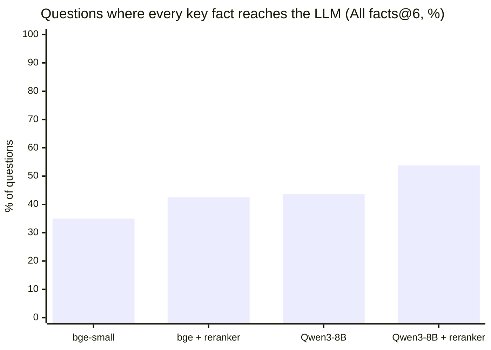

# Evaluation

How the assistant's quality was measured, what was tried, and what the numbers decided. Every number comes from a committed report in [`eval/results/`](eval/results/) unless marked otherwise, and every design decision mentioned has its full reasoning in [DECISIONS.md](DECISIONS.md).

## TL;DR

| | Result |
|---|---|
| Related code among the 6 sources the LLM gets | **92.5%** of questions with the default setup; with Qwen3-8B, **100%** with the reranker off and **97.5%** with it on |
| Every key fact of the answer among those sources | **at least 42.5%** of questions by default, **53.8%** with Qwen3-8B + reranker |
| Key facts stated by the chosen free LLM | **53.8%**, no false refusals |
| The 5 example questions, answered end to end | **21 of 22** answers complete, none with unsupported claims (runs not committed) |

The main lesson: "the search found related code" is not "the LLM got the answer". The strict measures below exist because the lenient one looked better than the answers were.

## The question set

46 questions in [`eval/questions.toml`](eval/questions.toml), each taken from a real Ultralytics GitHub issue (linked) and rewritten as a self-contained question:

- **40 in scope:** training 12, data 11, prediction 7, validation 2, export 4, specific models 4. 14 name a symbol or argument; 26 are plain language.
- **6 out of scope:** their answers live outside the indexed folders (`utils/`, `nn/`, `cfg/`). They check that the assistant says so instead of guessing.

Each in-scope question was labelled from the source code with:
- the code units that answer it (`relevant`), committed before any model was run (`8ca7a9d`, 15:15; first results in `e2857dd`, 15:32);
- 2–3 **key facts** a correct answer must contain (104 in total);
- the exact **evidence lines** (101 `path:start-end` ranges).

The key facts and evidence lines were committed after the embedding-model run but before any answer or fact was judged (`dfc5779`). The loader fails if a label doesn't match a real chunk.

## How quality is measured

Three measures of what reaches the LLM, from most lenient to strictest:

| Measure | Question it answers | How |
|---|---|---|
| **Hit@6** | Is *some* relevant code among the 6 sources? | Any `relevant` code unit in the top 6 |
| **Evidence@6** | How many of the answer's evidence lines are there? | Labelled lines found in the retrieved chunks |
| **Facts@6** / **All facts@6** | Is each key fact there? Is the *full* answer there? | An LLM judge reads the 6 sources; a "yes" counts only if it quotes a line that really is in them |

Why the strict ones were needed: on *"why do `val()` and `predict()` give different detections?"*, the search ranks `Model.val` second, a hit. But the two lines that answer the question (`conf=0.25` in `Model.predict`, `conf=0.001` in `BaseValidator.__init__`) are missing, so the answer misses the point. Hit@6 counts that question as solved; Facts@6 doesn't.

Answers are graded the same way: a judge from another model family checks which key facts each answer states, which claims the sources don't support, and whether it declined.

## What was tried, in order

Each experiment had its decision rule written down **before** it ran.

| # | Question | Rule fixed beforehand | Result | Decision |
|---|---|---|---|---|
| 1 | Which open-source embedding model? Four local candidates | Best Hit@5, unless a smaller model is within 3 points | Qwen3-0.6B 80.0%, **bge-small 77.5%**, Granite R2 77.5%, GTE-ModernBERT 72.5% | **bge-small**: one question behind, 18× smaller, 6.5× faster on CPU ([D18](DECISIONS.md)) |
| 2 | How many sources for the LLM? | The knee of the Hit@k curve | Hit@5 77.5%, Hit@6 80%, Hit@8 80% | **k = 6** ([D20](DECISIONS.md)) |
| 3 | Which free LLM? | Must decline at least half the out-of-scope questions; then the best key-fact coverage | **Cohere 53.8%**, dots-3 42.9%, Laguna 36.2% | **Cohere**, with dots-3 and Laguna as fallbacks ([D23](DECISIONS.md)) |
| 4 | A stricter prompt? | Manual comparison only | Fewer invented details, but it refused a question it could answer | **Reverted** to the first prompt ([D20](DECISIONS.md)) |
| 5 | Keyword search merged with vectors (hybrid, RRF)? | Keep only if Hit@6 doesn't drop | Hit@6 80.0% → 77.5% | **Off.** But the top 20 of each list hold the right code for 38/40, so ranking is the problem ([D24](DECISIONS.md)) |
| 6 | A local reranker to fix the ranking? | Under ~2 s per question | Over a minute per question on CPU | **Stopped** ([D24](DECISIONS.md)) |
| 7 | A hosted reranker (3 tried)? | At least +2 questions at Hit@6, under ~2 s | Hit@6 32 → **37**, +0.6 s, free | **On by default** ([D26](DECISIONS.md)) |
| 8 | Is the answer really in the sources? | (new measure) | Hit@6 92.5%, but every key fact only for **42.5%** | **Facts@6** becomes the main measure ([D27](DECISIONS.md)) |
| 9 | A larger open-source embedder, Qwen3-8B, served by OpenRouter? | At least +2 questions on Hit@6 or the strict measures | Hit@6 **40/40** (39/40 with the reranker); Facts@6 63% → 71–74% | **A switch in the chat**; bge-small stays the default because it is free and local ([D28](DECISIONS.md)) |

## Retrieval results



| Search | Hit@1 | Hit@6 | MRR@10 | Evidence@6 | Facts@6 | All facts@6 | Latency |
|---|---|---|---|---|---|---|---|
| bge-small, vector only | 52.5% | 80.0% | 0.626 | 50.8% | 55.4% | 35.0% | 0.14 s |
| bge-small, hybrid (RRF) | 57.5% | 77.5% | 0.664 | 50.7% | 53.8% | 41.0% | 0.20 s |
| **bge-small + reranker (default)** | 62.5% | 92.5% | 0.738 | 63.3% | 62.9% | 42.5% | 0.76 s |
| Qwen3-8B, vector only | **77.5%** | **100%** | **0.865** | **69.3%** | 71.4% | 43.6% | 0.53 s |
| Qwen3-8B + reranker | 60.0% | 97.5% | 0.749 | 69.1% | **73.9%** | **53.8%** | 1.15 s |

Latency is the median search time per question, including embedding the question on CPU or through the API. In three runs (bge-small hybrid, Qwen3-8B vector only, and Qwen3-8B + reranker) the judge failed on one question, which is left out, so their Facts@6 and All facts@6 are out of 39 questions.

**What the numbers say:**
- **Qwen3-8B is the only clear improvement.** With vector search alone it fixes all 8 questions bge-small misses and breaks none (sign test p ≈ 0.008). The reranker's 6 fixed and 1 broken (p ≈ 0.12) is promising but not conclusive at this size.
- **On top of Qwen3-8B, the reranker is mixed.** It brings the full answer to 4 more questions but pushes the best match down (Hit@1 77.5% → 60.0%), so it stays a switch.
- **Where retrieval still fails:** answers that are a single line inside a method about something else, e.g. the `conf` defaults above, or `nms is False` inside `setup_model`. Neither embedder links "different detections" or "disable NMS" to those lines.

Full reports: [`retrieval.md`](eval/results/retrieval.md) (embedding models, per-category results and failure analysis), [`search.md`](eval/results/search.md) (search strategies, per question), [`search_qwen3-embedding-8b.md`](eval/results/search_qwen3-embedding-8b.md).

## Answer results

**Choosing the LLM.** The free candidates answered all 46 questions from the same retrieved sources. The judge, `nvidia/nemotron-3-super-120b-a12b:free`, comes from another model family to avoid self-preference.

| Model | Key facts stated | Fully correct | Grounded | Citations OK | Out-of-scope declined | False refusals | Median latency |
|---|---|---|---|---|---|---|---|
| **`cohere/north-mini-code:free`** | **53.8%** | **32.5%** | 77.8% | 52.5% | 3/6 | **0%** | 10.1 s |
| `dots-studio/dots-3-note-preview:free` | 42.9% | 20.0% | **82.2%** | **80.0%** | 3/6 | **0%** | 15.9 s |
| `poolside/laguna-s-2.1:free` | 36.2% | 12.5% | 80.4% | 65.0% | 4/6 | 18.8% | **8.5 s** |

A fourth candidate, Gemma-4-31B, was rate-limited upstream for 37 of 46 questions and is reported as unavailable rather than ranked. This run used vector-only retrieval, before the reranker existed.

**The 5 example questions, with the final setup.** Each was answered with both embedding models, the reranker on and the free LLM chain, then re-run:

| Question | Answers | Every key fact | Unsupported claims |
|---|---|---|---|
| Learning rate schedule (lr0, lrf) | 4 | 4 | 0 |
| When mosaic switches off | 4 | 4 | 0 |
| Default augmentations | 4 | 4 | 0\* |
| YOLO-World custom classes | 4 | 4 | 0 |
| TensorRT export | 6 | 5 | 0 |

\* Judged against key facts that describe the pipeline. The answer shown in [docs/examples.md](docs/examples.md) presents steps that are off by default (`0.0` in `cfg/default.yaml`, which is not indexed) as applied: see the note there.

Six other candidates fell short and were not used as examples: resume training, COCO-to-YOLO conversion, several RTSP streams, Albumentations, CoreML export with NMS and FastSAM prompts.

Full report: [`answers.md`](eval/results/answers.md), with every answer and verdict in `answers.jsonl`.

## Can the judges be trusted?

Both judges were checked against a human (the author), on random samples reviewed **blind**, without seeing the judge's verdicts.

| Judge | Sample | Agreement | What disagreed |
|---|---|---|---|
| Answer judge (key facts stated) | 10 answers, 25 facts | **25/25**, Cohen's κ = 1.0 | Nothing. Borderline cases, such as a correct alternative solution, were treated the same way |
| Fact judge (key facts in the sources) | 10 questions, 25 facts | **19/25 (76%)**, κ = 0.53 | 6 facts the judge missed although they were in the sources; it was never more lenient |

So the answer judge is reliable for grading answers, and the fact judge is **conservative**: Facts@6 and All facts@6 are lower bounds. They remain fair for comparing setups, because every setup is graded by the same judge.

The review sheets are committed: [`judge_review.md`](eval/results/judge_review.md) and [`fact_review.md`](eval/results/fact_review.md).

## Weak spots of this evaluation

- **Small:** 40 questions, so one question is 2.5 points. Only large differences are meaningful, like Qwen3-8B's.
- **One labeller:** the questions, labels and key facts were written by one person who knew the codebase, and some valid answers may be missing from the labels.
- **One set, many decisions:** the same 40 questions guided every choice. Fixing each rule before its run limits overfitting to them, but a fresh held-out set would confirm the choices.
- **Key facts reward the canonical answer:** a correct but different solution scores 0, so coverage underestimates usefulness.
- **Free LLMs vary from run to run:** answer numbers move between runs, which is why the examples were re-run.
- **The answer evaluation predates the reranker and Qwen3-8B.** The examples were checked with the final setup, but the 46-question answer run was not repeated.

## How to reproduce

```bash
uv run code-assistant eval retrieval                 # embedding models: ~2 min on CPU, no API calls
uv run code-assistant eval search --facts            # search strategies + fact judge
uv run code-assistant eval search --facts --embedding-model qwen/qwen3-embedding-8b
uv run code-assistant eval answers                   # LLMs + answer judge
uv run code-assistant eval review                    # blind review sheet, then: eval agreement
```

- `eval retrieval` uses the shipped vectors in `embeddings/`, so it only downloads the models (~2.5 GB) and embeds the 40 questions.
- The others call OpenRouter: about 160 free requests per `eval search --facts` run, and 92 per LLM for `eval answers`. They need a key with at least $10 of credit purchased, which raises the free limit from 50 to 1,000 requests a day. Free models don't spend the credit.
- LLM-graded numbers vary slightly between runs. Every answer and verdict used here is committed, so it can be inspected without re-running anything.
